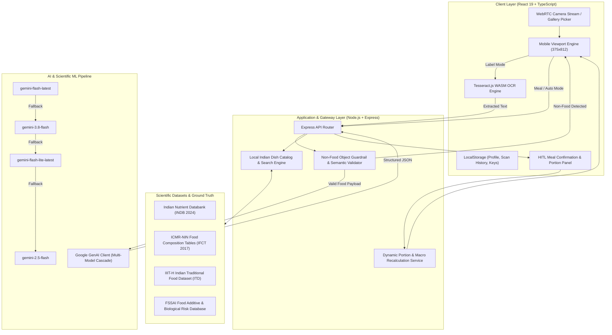
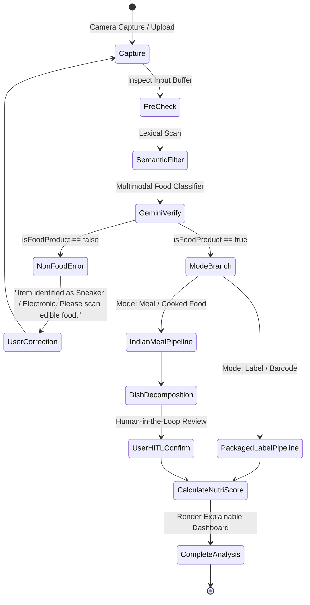

<div align="center">

# 🥗 NutriLens AI

### *Next-Generation Multimodal Food Recognition, Human-in-the-Loop Clinical Nutrition Intelligence & Indian Dietary Analytics*

[](https://opensource.org/licenses/MIT)
[](https://react.dev/)
[](https://www.typescriptlang.org/)
[](https://tailwindcss.com/)
[](https://ai.google.dev/)
[](https://vitejs.dev/)
[](https://nodejs.org/)
[](https://www.nin.res.in/)

<br />

<p align="center">
  <b>NutriLens AI</b> is an enterprise-grade, explainable AI platform bridging <b>Machine Learning</b> and <b>Human-Computer Interaction (HCI)</b> to demystify complex nutrition. Designed specifically for <b>Indian culinary ecosystems</b> and <b>ultra-processed packaged food transparency</b>, NutriLens fuses on-device OCR, resilient multimodal vision models, calibrated nutritional databases (ICMR-NIN IFCT 2017 & INDB 2024), and human-in-the-loop uncertainty estimation.
</p>

[Live Demo](#quick-start) • [System Architecture](#system-architecture) • [HCI & XAI Framework](#human-computer-interaction--explainable-ai-xai) • [Scientific Datasets](#scientific-datasets--provenance) • [API Reference](#restful-api-specification) • [Getting Started](#installation--setup)

---

</div>

## 📌 Table of Contents

- [Executive Summary & Motivation](#executive-summary--motivation)
- [System Architecture](#system-architecture)
- [Core Modalities & Capabilities](#core-modalities--capabilities)
  - [1. Packaged Food OCR & Label Intelligence](#1-packaged-food-ocr--label-intelligence)
  - [2. Authentic Indian Meal Vision & Decomposition](#2-authentic-indian-meal-vision--decomposition)
  - [3. Nutri-Score & Biological Risk Assessment](#3-nutri-score--biological-risk-assessment)
  - [4. Budget-Conscious Healthier Alternatives (INR ₹)](#4-budget-conscious-healthier-alternatives-inr-)
  - [5. Anti-Hallucination & Non-Food Guardrails](#5-anti-hallucination--non-food-guardrails)
  - [6. Grounded Conversational AI Dietitian](#6-grounded-conversational-ai-dietitian)
- [Human-Computer Interaction & Explainable AI (XAI)](#human-computer-interaction--explainable-ai-xai)
  - [Human-in-the-Loop (HITL) Interactive Confirmation](#human-in-the-loop-hitl-interactive-confirmation)
  - [Epistemic Uncertainty vs. Visual Confidence](#epistemic-uncertainty-vs-visual-confidence)
  - [Heuristic Usability Compliance (Nielsen Norman Group)](#heuristic-usability-compliance-nielsen-norman-group)
- [Scientific Datasets & Provenance](#scientific-datasets--provenance)
- [Technical Stack](#technical-stack)
- [RESTful API Specification](#restful-api-specification)
- [Project Directory Structure](#project-directory-structure)
- [Installation & Setup](#installation--setup)
- [Environment Variables](#environment-variables)
- [Academic Citation & Research Reference](#academic-citation--research-reference)
- [License & Contributors](#license--contributors)

---

## 🌟 Executive Summary & Motivation

### The Crisis in Nutritional Literacy
Global nutritional tracking tools (MyFitnessPal, Yuka, Lose It!) are structurally biased toward Western single-item whole foods and standard barcodes. When applied to Indian culinary realities and regional packaged goods, they fail critically:
1. **The Indian Thali Problem**: Authentic Indian meals are non-discrete, multi-component assemblies (e.g., Dal Tadka, Jeera Rice, Phulka, Sabzi, and Chutney) where oil, ghee, and moisture variations alter caloric density by upwards of **40%**. Point-estimate classifiers introduce dangerous false certainty.
2. **The Front-of-Pack Deception**: Ultra-processed food products marketed across India frequently exploit regulatory loopholes, masking palm oil, hidden maltodextrin, emulsifiers, and excessive sodium behind misleading health badges ("High Protein", "Natural", "Digestive").
3. **The Black-Box AI Fallacy**: Traditional computer vision systems output opaque classifications without giving users any agency to verify, adjust portion sizes, or understand the provenance of the nutritional figures.

### The NutriLens Paradigm
NutriLens AI redefines nutrition tracking as an **Explainable, Human-in-the-Loop Intelligence System**:
- **Dual Engine Pipeline**: Instant switching between **Packaging Label OCR** (for commercial products) and **Multimodal Meal Decomposition** (for freshly prepared dishes).
- **Scientifically Grounded**: Backed by the **Indian Food Composition Tables (IFCT 2017)** from ICMR-NIN and the **Indian Nutrient Databank (INDB 2024)**.
- **Uncertainty Quantification**: Every meal nutrient estimate reports a strict tripartite bounds system ($\text{Minimum} \le \text{Estimated} \le \text{Maximum}$), explicitly communicating cooking and recipe variance.
- **Economic Feasibility**: Recommends healthier swaps within the **identical Indian budget tier** (e.g., swapping a ₹20 bag of extruded fried snacks for roasted foxnuts or makhana).

---

## 🏗️ System Architecture

NutriLens AI operates on a modern, decoupled client-server architecture combining edge-accelerated WebAssembly processing with high-throughput cloud inference and resilient fallback cascades.



---

## 🔬 Core Modalities & Capabilities

### 1. Packaged Food OCR & Label Intelligence
- **On-Device Text Extraction**: Utilizes `tesseract.js` executing in a WebAssembly background worker to extract packaging text directly on the client, minimizing latency and preserving user data privacy.
- **Multimodal Regex & LLM Parsing**: Seamlessly parses mandatory Indian nutrition disclosure panels (Per 100g / Per Serve metrics) across Calories, Saturated Fats, Trans Fats, Added Sugars, Sodium, Protein, and Dietary Fiber.
- **Additive Extraction**: Scans ingredient declarations for INS numbers, hydrogenated oils, artificial colorants, and synthetic preservatives.

### 2. Authentic Indian Meal Vision & Decomposition
- **Fine-Grained Dish Decomposition**: Categorizes multi-dish platters into individual items (e.g., Dal, Roti, Rice, Paneer Sabzi, Raita, Salad).
- **IIIT Hyderabad ITD Alignment**: Integrated with the taxonomy of the IIIT-H Indian Traditional Food Dataset (ITD) containing 50+ classes of authentic Indian foods.
- **Visual Confidence Calibration**: Separates vision classification probability ($p \in [0, 1]$) from recipe nutritional variance, mitigating the risk of pseudo-precision.

### 3. Nutri-Score & Biological Risk Assessment
- **Algorithmic Grading**: Computes an objective letter score (**A**, **B**, **C**, **D**, **F**) and normalized 0–100 index based on European Nutri-Score methodologies adapted for Indian nutritional density guidelines.
- **FSSAI Standards Screening**: Flags ingredients exceeding recommended daily limits or containing ingredients flagged by the Food Safety and Standards Authority of India (FSSAI).
- **Biological Risk Profiling**: Provides deep clinical pathology explanations (e.g., Palmolein Oil $\rightarrow$ Elevated LDL-C and atherosclerotic plaque progression; High Maltodextrin $\rightarrow$ Glycemic spiking and insulin resistance).

```
┌─────────────────────────────────────────────────────────────┐
│                     NutriLens Score Index                   │
├─────────┬──────────────┬────────────────────────────────────┤
│ Grade A │ 80 - 100 pts │ Whole foods, high fiber & protein  │
│ Grade B │ 65 - 79 pts  │ Balanced profile, low saturated fat│
│ Grade C │ 50 - 64 pts  │ Moderate sugar/sodium; consume mod.│
│ Grade D │ 35 - 49 pts  │ High processing, elevated fats/salt│
│ Grade F │ 0 - 34 pts   │ Ultra-processed, high harmful risks│
└─────────┴──────────────┴────────────────────────────────────┘
```

### 4. Budget-Conscious Healthier Alternatives (INR ₹)
Unlike Western applications recommending inaccessible imported superfoods, NutriLens generates **contextually feasible Indian grocery alternatives**:
- Preserves the consumer's price tier (e.g., ₹10 / ₹20 / ₹50 parity).
- Direct calorie, saturated fat, and sodium comparative delta (e.g., *“380 kcal vs 558 kcal · 80% less saturated fat”*).
- Highlights clean Indian brands and traditional whole-food substitutes (e.g., Makhana, Roasted Chana, Sattu drinks, Baked Namkeen).

### 5. Anti-Hallucination & Non-Food Guardrails
Computer vision models frequently hallucinate nutritional values when presented with non-edible objects. NutriLens implements a two-tier verification layer:
1. **Semantic Ingestion Filter**: Fast lexical check rejecting shoes, phones, laptops, clothing, hardware, and cosmetics.
2. **Vision Multimodal Verification**: Forces Gemini Vision into a strict classification check before running nutritional estimation. If a sneaker or laptop is scanned, the engine terminates inference and displays a clear explanation of why non-food objects cannot be analyzed.



### 6. Grounded Conversational AI Dietitian
- Real-time conversational assistant equipped with full contextual knowledge of the currently scanned product.
- Synthesizes findings with the user's personal dietary profile:
  - **Allergen Warnings**: Dynamic alerts for gluten, lactose, peanuts, soy, tree nuts, and shellfish.
  - **Chronic Condition Adjustments**: Tailored recommendations for hypertension (sodium limit: 2300mg/day) and diabetes (glycemic index warnings).
  - **Macro Tracking**: Evaluates the meal against daily protein and caloric targets.

---

## 🧠 Human-Computer Interaction & Explainable AI (XAI)

NutriLens was architected from first principles as an HCI research artifact, specifically exploring user agency, calibrated trust, and algorithmic accountability in healthcare AI.

### Human-in-the-Loop (HITL) Interactive Confirmation
Machine learning vision models are inherently probabilistic. In real-world culinary contexts, automated recognition can misidentify visually similar curries (e.g., Paneer Butter Masala vs. Shahi Paneer vs. Dal Makhani). 

Rather than imposing autonomous, black-box decisions onto the user, NutriLens inserts an interactive disambiguation boundary:
1. **Interactive Dish Catalog**: Users can review every detected dish, substitute incorrect predictions from an indexed catalog of authentic Indian recipes, or add uncaptured sides.
2. **Serving & Gram Weight Sliders**: Users fine-tune portions using both intuitive kitchen metrics (*“1 katori / 2 bowls”*) and calibrated gram weights.
3. **Reactive Mathematical Recalculation**: Adjusting a slider triggers an instant recalculation via the backend (`/api/v1/meals/recalculate`), updating macro totals and uncertainty boundaries in real time.

```
       Visual Vision Output (Probabilistic)
                      │
                      ▼
       ┌──────────────────────────────┐
       │   HITL Confirmation Panel    │  ◄── User inspects, edits & adjusts
       └──────────────┬───────────────┘
                      │
                      ▼
       Deterministic Scientific Calibration
                      │
                      ▼
       Calibrated Nutrient Bounds ([Min, Est, Max])
```

### Epistemic Uncertainty vs. Visual Confidence
Traditional nutrition apps present point-estimate numbers (e.g., *"This curry contains exactly 412 calories"*), generating a dangerous illusion of clinical accuracy.

NutriLens resolves this by distinguishing between:
- **Visual Recognition Confidence ($p_{vis}$)**: The model's probability that an object is *Dal Tadka*.
- **Recipe Nutritional Variance ($[\text{Min}, \text{Max}]$)**: The mathematical spread based on real-world culinary variability (e.g., tadka ghee volume, water dilution, dal lentil density).

$$E_{\text{nutrient}} = \left[ C_{\text{ref}} \times (1 - \sigma) \times \frac{w}{100}, \quad C_{\text{ref}} \times \frac{w}{100}, \quad C_{\text{ref}} \times (1 + \sigma) \times \frac{w}{100} \right]$$

Where:
- $C_{\text{ref}}$ is the base nutrient concentration per 100g from the ICMR-NIN / INDB reference tables.
- $\sigma$ is the validated recipe uncertainty percentage (typically $15\% - 30\%$).
- $w$ is the user-confirmed portion weight in grams.

### Heuristic Usability Compliance (Nielsen Norman Group)

| Usability Heuristic | NutriLens Architectural Implementation |
| :--- | :--- |
| **1. Visibility of System Status** | Real-time multi-stage status indicator (`Capturing` $\rightarrow$ `Running OCR` $\rightarrow$ `Analyzing with Gemini` $\rightarrow$ `Calibrating Macros`). |
| **2. Match Between System & Real World** | Indian culinary terminology (katoris, rotis, tadka, dal) and regional currency format (₹ INR). |
| **3. User Control & Freedom** | Full HITL confirmation modal allowing users to override, swap, or delete any AI suggestion before logging. |
| **4. Error Prevention** | Semantic and multimodal non-food guardrail preventing accidental scans of non-edible objects. |
| **5. Recognition Rather Than Recall** | Visual nutrition cards with color-coded ratings (Green: Good, Amber: Mod, Crimson: High) and visual score rings. |
| **6. Flexibility & Efficiency of Use** | Dual-input paradigm: instant camera viewfinder scan or lightning-fast instant text search. |
| **7. Help Users Recognize Errors** | Human-readable diagnostics when API quotas are exceeded, images are blurry, or packaging text is illegible. |

---

## 📚 Scientific Datasets & Provenance

NutriLens relies on peer-reviewed, empirically validated food composition tables and datasets. Nutritional profiles are explicitly isolated from raw computer vision scores.

```
src/data/ml/
├── iiith_itd_class_map.json              # Taxonomy mapping for 50+ Indian dishes
├── iiith_recognition_calibration_v1.json # Recognition calibration metrics
├── iiith_segmentation_model_v1.json      # Segmentation & anchor bounding profiles
├── iiith_to_nutrition_map.json           # Class-to-nutrition relational mappings
├── indian_nutrition.py                   # Python validation & schema verification
└── indian_nutrition_profiles.json        # Calibrated nutritional composition catalog
```

### Reference Citations & Ground Truth Sources

| Dataset / Source | Authority / Publisher | Scope & Usage in NutriLens |
| :--- | :--- | :--- |
| **Indian Nutrient Databank (INDB 2024)** | Vijayakumar et al., *Current Developments in Nutrition* (DOI: `10.1016/j.cdnut.2024.103790`) | Standard serving concepts, recipe terminology, and macro coverage for authentic cooked Indian meals. |
| **Indian Food Composition Tables (IFCT 2017)** | ICMR - National Institute of Nutrition (NIN), Hyderabad | Laboratory-analyzed nutrient values per 100g for primary Indian food ingredients, pulses, cereals, and vegetables. |
| **IIIT Hyderabad Indian Traditional Food Dataset (ITD)** | CVIT, IIIT Hyderabad | Visual taxonomy, class mappings, and food segmentation anchors for authentic Indian cuisine. |
| **FSSAI Food Safety Standards** | Food Safety and Standards Authority of India (FSSAI) | Regulatory thresholds for saturated fat, sodium limits, food additives, emulsifiers, and INS classification. |
| **USDA FoodData Central** | Agricultural Research Service, US Department of Agriculture | Supplementary reference data for raw fruits, basic whole produce, and generic commodities. |

---

## 💻 Technical Stack

### Frontend Architecture
- **Framework**: [React 19](https://react.dev/) (`19.0.1`) with TypeScript (`5.7+`)
- **Build Tool**: [Vite 8](https://vitejs.dev/) with `@vitejs/plugin-react`
- **Styling**: [Tailwind CSS v4](https://tailwindcss.com/) (`@tailwindcss/vite` modern CSS-first engine)
- **Animations**: [Motion](https://motion.dev/) (Framer Motion v12) for layout transitions
- **Edge OCR**: [Tesseract.js](https://tesseract.projectnaptha.com/) (`v7.0.0`) client-side WebAssembly
- **Iconography**: [Lucide React](https://lucide.dev/) (`0.546.0`)

### Backend & Middleware
- **Runtime**: Node.js 20+ with [TSX](https://github.com/privatenumber/tsx) runtime execution
- **Server Framework**: [Express 4](https://expressjs.com/) with high-capacity 15MB base64 JSON payload support
- **AI SDK**: [@google/genai](https://www.npmjs.com/package/@google/genai) (`v2.4.0`)
- **Vite Middleware**: Seamless Vite SSR development server embedded directly inside Express

### Machine Learning & AI
- **LLM Backbone**: Google Gemini Multimodal APIs with automatic failover across:
  - `gemini-flash-latest` (Primary low-latency high-throughput)
  - `gemini-3.8-flash` (Next-gen reasoning engine)
  - `gemini-flash-lite-latest` (Resource-conserving fallback)
  - `gemini-2.5-flash` (Ultra-stable legacy fallback)
- **Computer Vision Baseline**: PyTorch MobileNetV3 feature extractor & Scikit-Learn Random Forest Nutri-Score classifier

---

## 🔌 RESTful API Specification

The Express backend provides clean, strongly-typed JSON endpoints for complete food intelligence:

### 1. `POST /api/scan/realtime-analysis`
Executes real-time packaged food analysis or meal recognition from an image and/or query string.

#### Request Headers & Body
```http
POST /api/scan/realtime-analysis HTTP/1.1
Content-Type: application/json
x-gemini-api-key: <OPTIONAL_CLIENT_KEY>

{
  "query": "Kurkure Masala Munch",
  "imageDataUrl": "data:image/jpeg;base64,...",
  "ocrText": "Energy 558 kcal, Total Fat 34.5g, Sodium 890mg..."
}
```

#### Response (Food Product)
```json
{
  "success": true,
  "isFoodProduct": true,
  "productName": "Kurkure Masala Munch",
  "brand": "PepsiCo India",
  "category": "Packaged Snack",
  "servingSize": "30g",
  "budgetEstimate": "₹20",
  "kcal": 558,
  "nutrients": [
    {
      "name": "Calories",
      "value": "558 kcal",
      "per100g": 558,
      "rating": "bad",
      "detail": "Very high energy density"
    },
    {
      "name": "Saturated Fat",
      "value": "15.6 g",
      "per100g": 15.6,
      "rating": "bad",
      "detail": "High — raises LDL cholesterol"
    }
  ],
  "harmfulIngredients": [
    {
      "name": "Palmolein Oil",
      "category": "Fat / Oil",
      "severity": "high",
      "healthEffects": "Contains over 50% saturated palmitic acid",
      "biologicalRisk": "Increases systemic vascular inflammation and arterial stiffness"
    }
  ],
  "alternatives": [
    {
      "name": "Roasted Makhana (Pudina Punch)",
      "brand": "Farmley",
      "priceINR": "₹20",
      "budgetBadge": "Same Budget (~₹20)",
      "reason": "Air-roasted lotus seeds with zero palm oil",
      "estimatedScore": 88,
      "healthHighlights": ["Zero Palm Oil", "80% Less Saturated Fat"],
      "calorieComparison": "360 kcal vs 558 kcal",
      "fatReduction": "80% less saturated fat"
    }
  ]
}
```

#### Response (Non-Food Detected)
```json
{
  "success": true,
  "isFoodProduct": false,
  "detectedObject": "Smartphone",
  "message": "Not a food product. NutriLens identified this item as \"Smartphone\". NutriLens can only analyze edible packaged food items, groceries, snacks, beverages, and meals."
}
```

---

### 2. `POST /api/v1/meals/analyze`
Decomposes an Indian meal photo into discrete dishes with confidence ratings and baseline portion estimates.

#### Request Body
```json
{
  "imageDataUrl": "data:image/jpeg;base64,..."
}
```

#### Response Structure
```json
{
  "success": true,
  "data": {
    "analysisId": "meal_1728834920",
    "status": "complete",
    "requiresUserConfirmation": true,
    "requiresPortionConfirmation": true,
    "recognition": {
      "status": "recognized",
      "modelLoaded": true,
      "modelName": "Gemini 3.8 Flash Vision",
      "confidence": 0.94,
      "message": "Recognized 3 dishes with calibrated portion estimates.",
      "nextAction": "review_portions"
    },
    "items": [
      {
        "itemId": "dish_plain_rice_1",
        "dishId": "plain_rice",
        "name": "Plain cooked rice",
        "category": "cereal_dish",
        "portion": {
          "selectedGrams": 160,
          "minimumGrams": 100,
          "maximumGrams": 250,
          "basis": "standard_portion_profile",
          "description": "One standard cooked serving"
        },
        "nutrients": {
          "estimated": { "calories": 208, "protein": 3.8, "fat": 0.5, "carbohydrates": 45.1, "fiber": 0.6, "sodium": 8 },
          "minimum": { "calories": 176, "protein": 3.2, "fat": 0.4, "carbohydrates": 38.3, "fiber": 0.5, "sodium": 6 },
          "maximum": { "calories": 239, "protein": 4.4, "fat": 0.6, "carbohydrates": 51.9, "fiber": 0.7, "sodium": 9 }
        }
      }
    ],
    "totals": {
      "estimated": { "calories": 540, "protein": 14.2, "fat": 12.8, "carbohydrates": 92.4, "sodium": 420 },
      "minimum": { "calories": 460, "protein": 12.1, "fat": 10.2, "carbohydrates": 78.5, "sodium": 350 },
      "maximum": { "calories": 620, "protein": 16.3, "fat": 15.4, "carbohydrates": 106.3, "sodium": 490 }
    }
  }
}
```

---

### 3. `POST /api/v1/meals/recalculate`
Dynamically recalculates nutrient bounds when users modify gram weights or swap ingredients in the HITL panel.

#### Request Body
```json
{
  "items": [
    { "dishId": "plain_rice", "portionGrams": 200, "portionBasis": "measured" },
    { "dishId": "dal_tadka", "portionGrams": 150, "portionBasis": "estimated" }
  ]
}
```

---

### 4. `POST /api/ai/ask`
Context-grounded nutritional conversation assistant with dietary profile awareness.

#### Request Body
```json
{
  "message": "Is this safe for my diabetic father?",
  "productContext": {
    "name": "Kurkure Masala Munch",
    "nutrients": [ ... ],
    "harmfulIngredients": [ ... ]
  },
  "userProfile": {
    "dietPreferences": ["Diabetic Friendly"],
    "sodiumLimit": 2000
  }
}
```

---

## 📂 Project Directory Structure

```
Nutrilens-ai/
├── .env.example                       # Reference environment variables
├── index.html                         # SPA HTML entrypoint with viewport meta
├── metadata.json                      # AI Studio capability declarations
├── package.json                       # Dependencies & script configurations
├── server.ts                          # Express API Gateway, Vite dev server, AI fallbacks
├── tsconfig.json                      # TypeScript configuration
├── vite.config.ts                     # Vite 8 config with Tailwind v4 & React plugins
│
└── src/
    ├── App.tsx                        # Root application shell & mobile bezel simulator
    ├── main.tsx                       # React DOM entrypoint
    ├── index.css                      # Global Tailwind CSS v4 styling rules
    ├── types.ts                       # Complete TypeScript schema definitions
    │
    ├── components/
    │   ├── MealAnalysisView.tsx       # Explainable meal dashboard with nutrient ranges
    │   ├── MealConfirmationPanel.tsx  # HITL interactive dish & gram adjuster panel
    │   └── NavBar.tsx                 # Persistent bottom navigation bar
    │
    ├── screens/
    │   ├── HomeScreen.tsx             # Daily summary, quick stats & recent logs
    │   ├── ScanScreen.tsx             # Camera viewfinder, OCR triggers & mode switchers
    │   ├── ResultsScreen.tsx          # Nutri-Score, additives, alternatives & AI chat
    │   ├── HistoryScreen.tsx          # Historical scan logs with filtering & search
    │   └── ProfileScreen.tsx          # Health goals, allergens & Gemini API key manager
    │
    ├── services/
    │   ├── cameraService.ts           # WebRTC camera capture & gallery file access
    │   ├── geminiService.ts           # Multimodal Gemini API calls & structured schemas
    │   ├── mealService.ts             # Meal API client & composition recalculations
    │   ├── mlService.ts               # Local ML backend bridge & feature importances
    │   ├── nutritionScoringService.ts # Nutri-Score calculation & rating thresholds
    │   ├── ocrService.ts              # Client-side Tesseract.js WASM OCR parser
    │   ├── realtimeFoodService.ts     # Real-time scan, search & chat proxy client
    │   └── storageService.ts          # Type-safe LocalStorage manager
    │
    └── data/
        ├── products.ts                # Packaged product lookup data
        └── ml/                        # ML taxonomies, calibrations & Indian nutrition catalog
            ├── iiith_itd_class_map.json
            ├── iiith_recognition_calibration_v1.json
            ├── iiith_segmentation_model_v1.json
            ├── iiith_to_nutrition_map.json
            ├── indian_nutrition.py
            └── indian_nutrition_profiles.json
```

---

## ⚡ Installation & Setup

### Prerequisites
- **Node.js**: `v20.0.0` or higher ([Download](https://nodejs.org/))
- **Package Manager**: `npm` (v10+), `bun`, or `pnpm`
- **Google Gemini API Key**: Free tier available at [Google AI Studio](https://aistudio.google.com/)

### 1. Clone the Repository
```bash
git clone https://github.com/Amrit-mishra07/Nutrilens-ai.git
cd Nutrilens-ai
```

### 2. Install Dependencies
```bash
npm install
```

### 3. Configure Environment Variables
Create a local `.env` file in the project root:
```bash
cp .env.example .env
```
Populate your Gemini API key in `.env`:
```env
GEMINI_API_KEY="AIzaSyYourGeminiApiKeyHere"
GEMINI_MODEL="gemini-flash-latest"
```

> [!TIP]
> You can also launch the application without setting `.env`! NutriLens includes an interactive **API Key Manager** in the **Profile** screen where you can securely paste and test your key anytime.

### 4. Launch Development Server
```bash
npm run dev
```
The server will boot on `http://localhost:3000` with hot-module reloading and full API gateway proxying enabled.

### 5. Production Build & Verification
```bash
# Type check TypeScript codebase
npm run lint

# Build optimized production bundle
npm run build

# Preview production build
npm run preview
```

---

## 🔑 Environment Variables

| Variable | Description | Default / Example | Required |
| :--- | :--- | :--- | :--- |
| `GEMINI_API_KEY` | Google Gemini API Key for multimodal food recognition & AI chat. | `AIzaSy...` | Recommended |
| `GEMINI_MODEL` | Preferred primary Gemini model identifier. | `gemini-flash-latest` | Optional |
| `PORT` | Local server port for Express and Vite. | `3000` | Optional |
| `VITE_ML_API_BASE_URL`| Custom endpoint for standalone Python ML microservices if hosted separately. | `http://localhost:8000` | Optional |

---

## 🎨 Design System & UX Anatomy

NutriLens features a mobile-first interface designed to simulate modern flagship healthcare applications. It renders inside an ergonomic phone frame (`375px × 812px`) with smooth transitions and status bar indicators.

### Clinical Color Palette
- 🟢 **Grade A / Healthy**: `#1B7A43` / `#E9F7EF` (Fresh Basil Green)
- 🟡 **Grade B / Good**: `#6BAF45` / `#EFF7E9` (Leaf Olive)
- 🟠 **Grade C / Moderate**: `#F5A623` / `#FFF4E0` (Warm Turmeric Amber)
- 🔴 **Grade D / High Concern**: `#E4483C` / `#FDEAE9` (Crimson Alert)
- ⛔ **Grade F / Critical**: `#B91C1C` / `#FEF2F2` (Deep Vermilion)
- 🌑 **Typography Primary**: `#0F1720` (Obsidian Slate)
- 🌘 **Typography Secondary**: `#5A6472` (Cool Grey)

---

## 📖 Academic Citation & Research Reference

If you use or adapt NutriLens AI for research, educational projects, or publications, please cite the repository and underlying food composition literature:

```bibtex
@software{nutrilens_ai_2026,
  author       = {Mishra, Amritanshu and NutriLens Contributors},
  title        = {NutriLens AI: Intelligent Food Recognition, Human-in-the-Loop Nutrition Calibration, and Indian Dietary Analytics},
  year         = {2026},
  publisher    = {GitHub},
  howpublished = {\url{https://github.com/Amrit-mishra07/Nutrilens-ai}},
  note         = {Semester 5 ML & HCI Capstone Project}
}

@article{vijayakumar2024indb,
  title        = {Indian Nutrient Databank (INDB): Development of a Standardized Dietary Database},
  author       = {Vijayakumar, S. and others},
  journal      = {Current Developments in Nutrition},
  volume       = {8},
  pages        = {103790},
  year         = {2024},
  doi          = {10.1016/j.cdnut.2024.103790}
}

@book{icmr_nin_ifct2017,
  title        = {Indian Food Composition Tables 2017},
  author       = {Longvah, T. and Ananthan, R. and Bhaskarachary, K. and Venkaiah, K.},
  year         = {2017},
  publisher    = {National Institute of Nutrition (ICMR)},
  address      = {Hyderabad, India}
}
```

---

## 📄 License & Contributors

This project is licensed under the **MIT License** — see the [LICENSE](LICENSE) file for details.

### Acknowledgments
- **National Institute of Nutrition (ICMR-NIN)** for the pioneering Indian Food Composition Tables (IFCT).
- **IIIT Hyderabad (CVIT)** for the Indian Traditional Food Dataset (ITD) research.
- **Google AI Studio** for state-of-the-art multimodal Gemini models.
- **Academic Mentors & Evaluators** for Semester 5 (2026) Machine Learning & Human-Computer Interaction course guidelines.

<br />

<div align="center">
  <sub>Built with ❤️ for healthier eating, transparency, and Indian nutritional science.</sub>
</div>
